<div align="center">

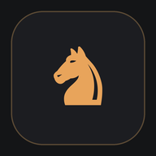

<h1>FUS chess</h1>

**Find Unique Strategy.**  
Шахматы + английский A1–B1. Одна партия — один новый ход и одно новое слово.

<a href="https://github.com/Fumetsu19/FUS_chess/releases/latest">
  
</a>
<a href="https://github.com/Fumetsu19/FUS_chess/releases">
  
</a>
<a href="https://github.com/Fumetsu19/FUS_chess/releases">
  
</a>


</div>

**FUS** = **FU**metsu + **S**trategy. Слоган: **Find Unique Strategy.** — «найди свою уникальную стратегию».

**Автор:** fumetsu · [github.com/Fumetsu19](https://github.com/Fumetsu19) · [исходный код](https://github.com/Fumetsu19/FUS_chess)

> Текущая поставка — **только Android** (по уточнённому требованию). iOS-папка удалена, Android-манифест фиксирует портретную ориентацию. Приложение полностью офлайн: SQLite, `shared_preferences` и JSON-ассеты, без бэкенда и сетевых API.

## Скачать

**[FUS chess 1.2.0 — APK](https://github.com/Fumetsu19/FUS_chess/releases/latest/download/fus-chess-1.2.0-release.apk)** · 68,3 МБ · Android 8.0+

Release собран с debug-ключом Flutter: подходит для установки и тестирования, для Google Play нужен собственный keystore.

[История изменений](CHANGELOG.md)

## Как это выглядит

| Главный экран | Урок |
|---|---|
| 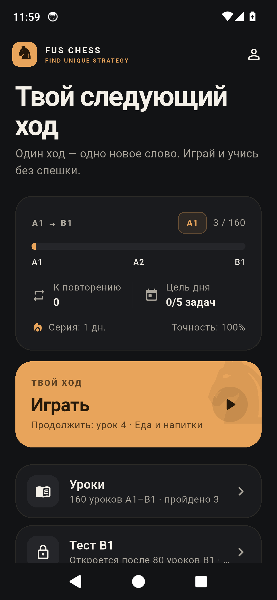 | 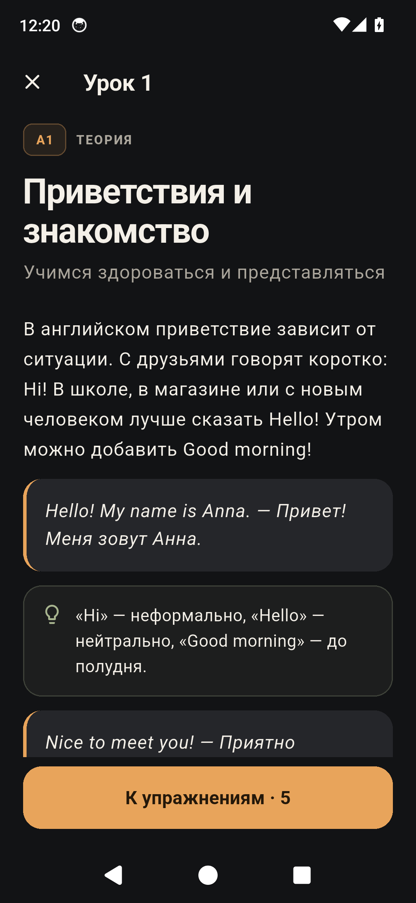 |

| Задача перед ходом | Результаты партии |
|---|---|
| 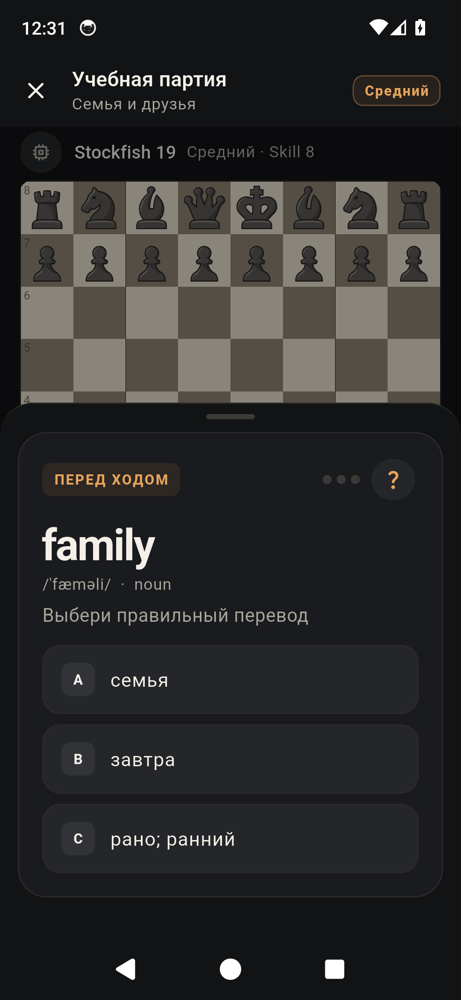 | 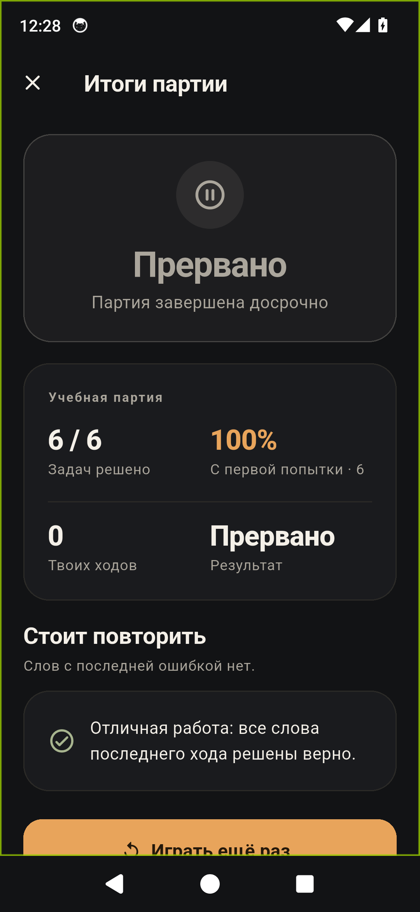 |

| Уроки A1/A2/B1 | Тест B1 |
|---|---|
| 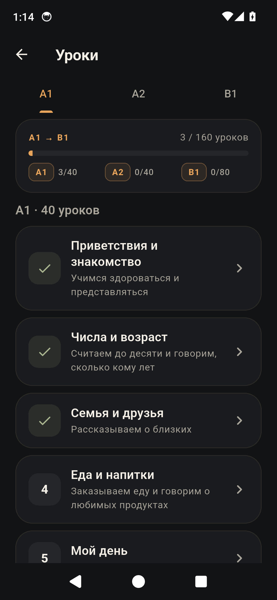 | 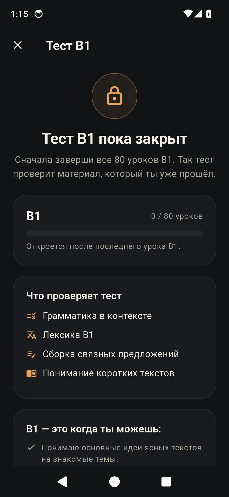 |

| Свободный режим | Обучение фигурам |
|---|---|
| 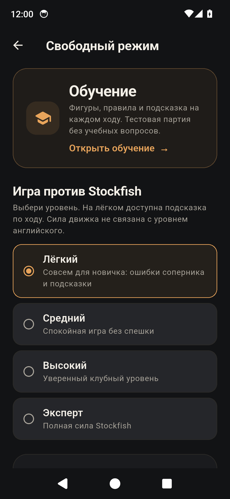 | 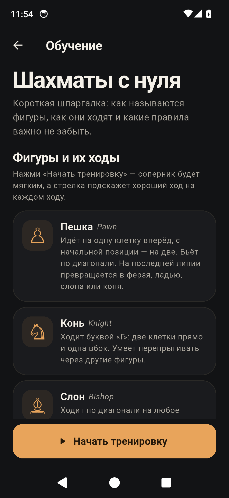 |

| Подсказка в лёгком режиме | Тренировочная партия |
|---|---|
| 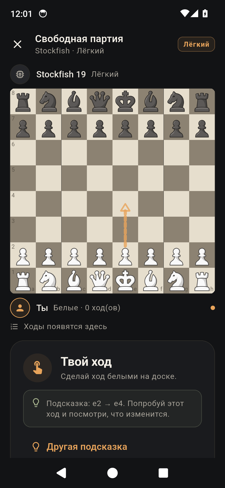 | 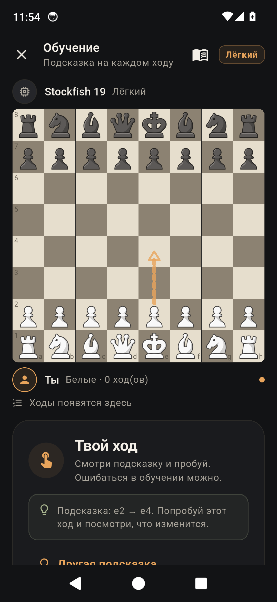 |

Скриншоты сделаны на Android-эмуляторе 1080×2340. Задача перед ходом открывается поверх доски, чтобы все три варианта ответа были видны без прокрутки; после ответа лист сам прокручивается к кнопке «К доске».

## Что реализовано

- [x] Главное меню: «Играть», «Уроки», «Тест B1», «Словарь», «Перестрелка», «Свободный режим», «Настройки».
- [x] Прогресс-бар **A1 → B1** по формуле `completed_lessons / planned_total`; `planned_total = 160`.
- [x] **160 уроков**: 40 A1 + 40 A2 (80 шагов до A2) и 80 B1; **642 слова**, **800 упражнений**.
- [x] Первые уроки усилены лексикой: в уроке 1 — 20 слов, в уроке 2 — 16; внутри одной партии слова не повторяются, пока не исчерпан пул.
- [x] Основной цикл: статья → 5 упражнений (`multiple_choice`, `fill_blank`, `build_sentence`) → партия.
- [x] Задача перед каждым ходом игрока: 3 попытки, подсказка «?», показ ответа после третьей ошибки, блокировка доски до завершения задачи.
- [x] Stockfish 19 через `multistockfish`: четыре уровня — от ultra-easy с ошибками соперника и подсказками до эксперта; отдельная ось от уровня английского.
- [x] **Подсказки по ходу**: в лёгком режиме — по кнопке, в обучении — автоматически на каждом ходу. Подсказка показывает стрелку на доске и объясняет ход, не задавая дополнительных вопросов.
- [x] Рокировка, взятие на проходе, превращение пешки — через `advanced_chess_board` / `chess`.
- [x] Упрощённый SM-2, due-очередь, приоритеты задач, счётчик «к повторению сегодня».
- [x] «Перестрелка»: английское слово → один из трёх переводов; мягкое влияние на SRS.
- [x] Адаптивность: слова с частыми ошибками приоритетнее; после 5 верных MC-ответов подряд по уроку включается тренировка fill_blank.
- [x] **B1-тест**: 30 вопросов по грамматике, лексике, письму и чтению; 5 текстов; проходной балл 70%; разбор по разделам и темам для повторения. Открывается после 80 уроков B1.
- [x] **Обучение шахматам** в «Свободном режиме»: все шесть фигур, как они ходят и называются, рокировка, взятие на проходе, превращение, шах и мат.
- [x] В тренировочной партии подсказка появляется каждый ход; если соперник рокируется, приложение мягко поясняет, что произошло.
- [x] Свободный режим без учебных задач; экран результатов и там, и после учебной партии.
- [x] Светлая/тёмная тема, звук хода/взятия/шаха/мата, сброс прогресса с подтверждением.
- [x] Профиль: всего задач, точность `first_try / total`, серия дней, победы.
- [x] Дневная цель: 1 урок **или** 5 задач.
- [x] Локальные WAV-звуки, сгенерированные для проекта; без внешних аудио-лицензий.

## Проверка

Окружение, в котором выполнялась проверка:

- Flutter 3.47.7 stable, Dart 3.13.5;
- JDK 17 (Microsoft OpenJDK);
- Android SDK 36, build-tools 36.0.0, NDK 28.2.13676358.

```bash
flutter pub get
flutter analyze
flutter test
flutter build apk --debug
flutter build apk --release
```

Результат тестов: **33 теста** — парсинг JSON/контракты, SRS, статистика, приоритеты задач, UCI-парсер, адаптивность, B1-тест, уровни сложности, обучение фигурам и widget-smoke главного экрана/закрытого B1-теста. APK:

- [fus-chess-1.2.0-release.apk](https://github.com/Fumetsu19/FUS_chess/releases/latest/download/fus-chess-1.2.0-release.apk) — 68,3 МБ (release-ассет);
- `dist/fus-chess-1.2.0-release.apk` — локальная копия того же APK;
- `build/app/outputs/flutter-apk/app-release.apk` — тот же release-APK после сборки;
- `build/app/outputs/flutter-apk/app-debug.apk` — debug-сборка для отладки.

Release-подпись пока использует debug-ключ из шаблона Flutter — для публикации настрой свой keystore в `android/app/build.gradle.kts`.

Сборка проверена установкой release-APK на Android-эмулятор: открываются уроки A1/A2/B1, тест B1 показывает корректное состояние блокировки до 80 уроков, Stockfish отвечает на ходы. Проверены «Свободный режим» → «Обучение»: все фигуры, правила, тренировочная партия с автоматической подсказкой `e2 → e4` и кнопка подсказки в лёгком режиме. Задача перед ходом появляется в bottom-sheet, после ответа лист сам прокручивается к «К доске». `flutter analyze` — без замечаний.

## Анализ пакетов

| Задача | Решение | Почему |
|---|---|---|
| Доска | `advanced_chess_board 3.1.0` | Квадратная доска с `AspectRatio(1)` и вертикальной раскладкой, `enableMoves` для блокировки, программные ходы движка, встроенный диалог превращения, рокировка/en passant, подсветка последнего хода. Зависимость — `chess 0.8.1`, без сети и аккаунтов. |
| Движок | `multistockfish 0.6.1` | Официальный пакет lichess.org, Stockfish 19 со встроенной лёгкой NNUE, Android. API `Stockfish.create()` + UCI stdin/stdout. Сборка нативной части идёт через NDK/CMake. |
| Правила/история | `chess 0.8.1` | Легальные ходы, FEN/PGN, флаги взятия/рока/превращения. Используется доской и игровым контроллером. |
| БД | `sqflite 2.4.4+2` | Нативный SQLite Android, DDL 1:1 из ТЗ. |
| Настройки | `shared_preferences 2.5.6` | Тема, звук, уровень движка; плюс вспомогательная адаптивность. |
| Состояние | `provider 6.1.5` | `ChangeNotifier` для настроек и игрового контроллера. |
| Звук | `audioplayers 6.8.1` | Короткие локальные WAV, низкая задержка. |

### Почему не `chess_interface`

`chess_interface 1.2.1` тоже умеет рокировку/en passant/превращение, но завязан на собственный провайдер, арбитр и таймер, а в README расходятся импорты (`chess_board_widget` / `chess_interface`). Для интеграции с внешним UCI-движком и собственной блокировкой доски `advanced_chess_board` даёт более прозрачный `ChessBoardController`. `chess_interface` остаётся задокументированной альтернативой.

### Звук

У доски есть `SoundPack`, но программные ходы Stockfish через `controller.makeMove()` его не вызывают. Поэтому звук классифицируется в `GameController` по последнему `chess.Move` и флагам: мат / шах / взятие / ход. Так звучат и ходы игрока, и ответы движка, и работает глобальный выключатель.

## Архитектура

```text
lib/
  main.dart, app.dart
  core/
    db/app_database.dart              DDL v1, открытие/сброс
    models/                           Lesson, Word, Reading, B1-тест, SRS, прогресс
    repositories/                     content / progress / srs / stats
    services/
      app_services.dart               composition root
      adaptive_store.dart             7-дневный журнал ошибок и MC-серия
      task_picker.dart                приоритеты задач, защита от повторов
      b1_test_builder.dart            сборка экзаменационных 30 вопросов
      stockfish_engine.dart           UCI, уровни, fallback
      sound_service.dart              локальные WAV
    theme/app_theme.dart
    widgets/                          общие карточки, бейджи, difficulty selector
  features/
    home/ lessons/ play/(lesson) game/ vocabulary/ shootout/
    b1_test/ free_play/ settings/ results/ profile/
assets/data/lessons.json, vocabulary.json, b1_reading.json
assets/sounds/{move,capture,check,mate}.wav
tool/                                 генераторы контента/звука/иконок (dev)
test/                                 33 теста
docs/ARCHITECTURE.md                  подробный план и обоснования
```

Подробный план, таблица уровней Stockfish и этапы реализации — в [docs/ARCHITECTURE.md](docs/ARCHITECTURE.md).

## Контракты данных

### `assets/data/lessons.json`

Корень: `version`, `planned_total: 160`, `lessons[]`.

Урок: `id, order, level (A1|A2|B1), title, summary, theory.blocks[], vocabulary_ids[], exercises[]`.

Блок теории: `type ∈ {text, example, note}`, `content`.

Упражнение:

- `multiple_choice`: `id, type, prompt, hint, options[], correct`;
- `fill_blank`: `id, type, prompt, hint, answer, accepted[]`;
- `build_sentence`: `id, type, prompt, hint, words[], answer`.

### `assets/data/vocabulary.json`

`id, en, ru, transcription, part_of_speech, example_en, example_ru, lesson_id, level`.

Сейчас: **160 уроков, 642 слова, 800 упражнений**. В уроке 1 — 20 слов, в уроке 2 — 16, чтобы первые партии не упирались в один и тот же короткий список. Ссылочная целостность `vocabulary_ids ↔ word.id` проверяется при загрузке; тест фиксирует контракт.

### `assets/data/b1_reading.json`

`id, level, title, text, question, options[], correct, explanation` — пять B1-текстов для раздела чтения итогового теста. Это дополнительный ассет, контракты уроков и словаря не изменены.

### SQLite

DDL из `SQLite.sql` применён без переименований и без новых колонок:

```sql
CREATE TABLE srs_cards (
  word_id        TEXT PRIMARY KEY,
  interval_days  INTEGER NOT NULL DEFAULT 1,
  ease           REAL    NOT NULL DEFAULT 2.5,
  reviews        INTEGER NOT NULL DEFAULT 0,
  next_review_at TEXT    NOT NULL,
  last_result    TEXT
);

CREATE TABLE lesson_progress (
  lesson_id     TEXT PRIMARY KEY,
  completed_at  TEXT,
  exercises_ok  INTEGER NOT NULL DEFAULT 0,
  exercises_all INTEGER NOT NULL DEFAULT 0
);

CREATE TABLE session_stats (
  id               INTEGER PRIMARY KEY AUTOINCREMENT,
  played_at        TEXT NOT NULL,
  lesson_id        TEXT,
  tasks_total      INTEGER,
  tasks_first_try  INTEGER,
  moves_made       INTEGER,
  game_result      TEXT
);
```

Добавлены только индексы (`next_review_at`, `played_at`), не меняющие контракт.

## Логика SRS

- Первый показ: `interval_days=1`, `ease=2.5`, `reviews=0`, `next_review_at=now+1 день`. Карточка создаётся при первой задаче со словом.
- Correct: `reviews++`, `interval=round(interval*ease)`, `ease=min(2.5, ease+0.1)`, `next=now+interval`.
- Wrong: `interval=1`, `ease=max(1.3, ease-0.2)`, `next=now+1 день`; `reviews` не увеличивается — буквально по контракту.
- «Перестрелка» (`soft`): меняет `ease` и `reviews`, **не** меняет `interval` и `next_review_at`.
- «Изучено» = `reviews >= 1 && last_result == 'correct'`.
- «К повторению сегодня» = карточки с `next_review_at <= now`.

Приоритет задачи перед ходом:

1. просроченные карточки: сначала больше ошибок за 7 дней, затем `last_result='wrong'`, затем более старый срок/меньший ease;
2. слова текущего урока, которых нет в SRS;
3. слова из завершённых уроков (слова с 3+ ошибками — в приоритете);
4. fallback — слова текущего урока.

Внутри одной партии `GameController` передаёт в TaskPicker набор уже показанных слов. Поэтому слово не повторяется, пока не исчерпан доступный пул; после этого начинается новый круг. Для урока 1 пул — 20 слов, для урока 2 — 16.

«Перестрелка» берёт due-очередь, затем проблемные слова, затем изученные. Один раунд — до 10 вопросов, один вариант ответа, три перевода.

### Адаптивность без изменения DDL

В утверждённых таблицах нет полей для «3 ошибки за 7 дней» и серии MC. Эти вспомогательные счётчики лежат в `shared_preferences` (`AdaptiveStore`), основной прогресс — в SQLite. Сброс прогресса очищает и БД, и эти ключи; тема/звук/уровень движка сохраняются.

- 3+ неверных ответа за 7 дней → слово раньше выбирается в due-очереди/перестрелке.
- 5 верных `multiple_choice` с первой попытки по одному уроку → следующий заход в урок тренирует письменные упражнения (fill_blank + build_sentence). Серия хранится по `lesson_id`.

## Игровой цикл

1. Статья урока.
2. Упражнения (3 попытки, подсказка, показ ответа).
3. `lesson_progress` сохраняется, открывается партия.
4. Перед каждым ходом белых — word task. `AdvancedChessBoard.enableMoves = false` до ответа/показа ответа.
5. После задачи доступна подсказка по ходу — без дополнительного вопроса; в лёгком режиме и обучении она бесплатна.
6. Ход игрока → звук → Stockfish (`go depth … movetime …`) → ход движка → следующая задача.
7. Мат/пат/ничья/выход → результаты.

| Уровень | Skill Level | depth | movetime | Особенность |
|---|---:|---:|---:|---|
| Лёгкий | 0 | 1 | 40 ms | 45% случайных легальных ходов + подсказки |
| Средний | 0 | 1 | 80 ms | бывший лёгкий |
| Высокий | 8 | 10 | 900 ms | бывший средний |
| Эксперт | 18 | 18 | 2500 ms | полная сила |

В интерфейсе свободного режима технические `Skill`-подписи не показываются: только названия уровней и понятные описания. Если нативный движок недоступен, партия не блокируется: контроллер делает случайный легальный ход и показывает предупреждение. Основной путь — Stockfish.

### Обучение и подсказки

- «Свободный режим» → верхняя карточка **«Обучение»**: все фигуры, их названия, ходы и особые правила.
- Тренировочная партия автоматически показывает стрелку лучшего хода на каждом ходу. Это тестовая игра, а не экзамен.
- Лёгкий уровень даёт кнопку «Подсказка»; средний/высокий/эксперт — без подсказок.
- В основном режиме с обучением подсказка по ходу доступна после решения языковой задачи и не требует ещё одного ответа.
- Если соперник делает рокировку, под доской появляется спокойная поясняющая строка.

### Результаты

Победа/поражение/ничья/прервано, «Задач решено X из Y», first-try и точность, слова с последним неверным ответом, кнопки «Играть ещё раз», «К урокам», «На главный экран». В свободном режиме блок задач скрыт.

## Запуск

```bash
# из корня проекта
flutter pub get
flutter run -d <android-device-id>
```

Требования к Android-сборке: JDK 17, Android SDK 36, NDK 28.2.13676358 (Flutter подтягивает его через Gradle/`sdkmanager`), CMake из Android SDK. Разрешение интернета не требуется.

Полезные команды:

```bash
flutter analyze
flutter test
flutter build apk --debug
flutter build apk --release   # подпись release нужно настроить отдельно
```

Генераторы контента (не входят в runtime):

```bash
python tool/generate_content.py
python tool/generate_sounds.py
python tool/generate_icon.py
```

## 160 уроков и B1-тест

- **A1** — 40 уроков: база общения, вещи, дом, одежда, время, кафе, магазин, дорога, хобби, профессии.
- **A2** — 40 уроков: поездки, отель, аэропорт, ресторан, банк, аренда, здоровье, технологии, книги, кино, чувства, планы.
- **B1** — 80 уроков: работа и карьера, обучение, путешествия и культура, здоровье, экология и общество, медиа, отношения, коммуникация, деньги, жильё, искусство.

B1-тест открывается после завершения всех 80 уроков B1:

- **30 вопросов** — 10 грамматических, 5 лексических, 5 fill_blank, 5 build_sentence и 5 на чтение;
- **70% (21/30)** — проходной балл;
- результат разбит по разделам, ошибочные темы ведут к урокам для повторения;
- тест тренировочный и проверяет дескрипторы B1 (понимание основных идей, знакомые темы, связное простое высказывание), но **не является официальным экзаменом или сертификатом**.

Пять текстов для чтения лежат в `assets/data/b1_reading.json`; вопросы B1-теста собираются из B1-упражнений и не требуют интернета.

## Дальше

- B2/C1-контент, расширение словаря и новые типы заданий.
- Больше reading/listening-практики и официальные пробные форматы.
- Количество уроков не зашито в код: новые темы добавляются через JSON без изменения экранов.

## Ограничения и осознанные решения

- **Только Android** в текущей поставке; iOS-проект не поддерживается.
- `reviews` увеличивается только при правильном ответе — это буквальное прочтение контракта SRS.
- DDL не хранит consecutive-wrong, поэтому 7-дневный журнал ошибок и MC-серия — в `shared_preferences`; это не меняет поля SQLite.
- `shared_preferences_android 2.5.1` ломает release-сборку без keep-правил. В `android/app/proguard-rules.pro` добавлены шесть правил из upstream-фикса [flutter/packages#13311](https://github.com/flutter/packages/pull/13311); после выхода исправленного пакета их можно удалить. На этой сборке release проверен установкой на эмулятор.
- Пауза/часы/рейтинг/онлайн-игра не добавлялись — вне требований.
- Stockfish GPL-3.0: при распространении APK нужно соблюсти GPL (предоставить соответствующий исходный код/предложение). Подробности — [THIRD_PARTY_NOTICES.md](THIRD_PARTY_NOTICES.md).
- Пакет `advanced_chess_board` поставляет фигуры Chess.com; при публикации проверь условия использования ассетов.

## Автор

fumetsu — [https://github.com/Fumetsu19](https://github.com/Fumetsu19)


